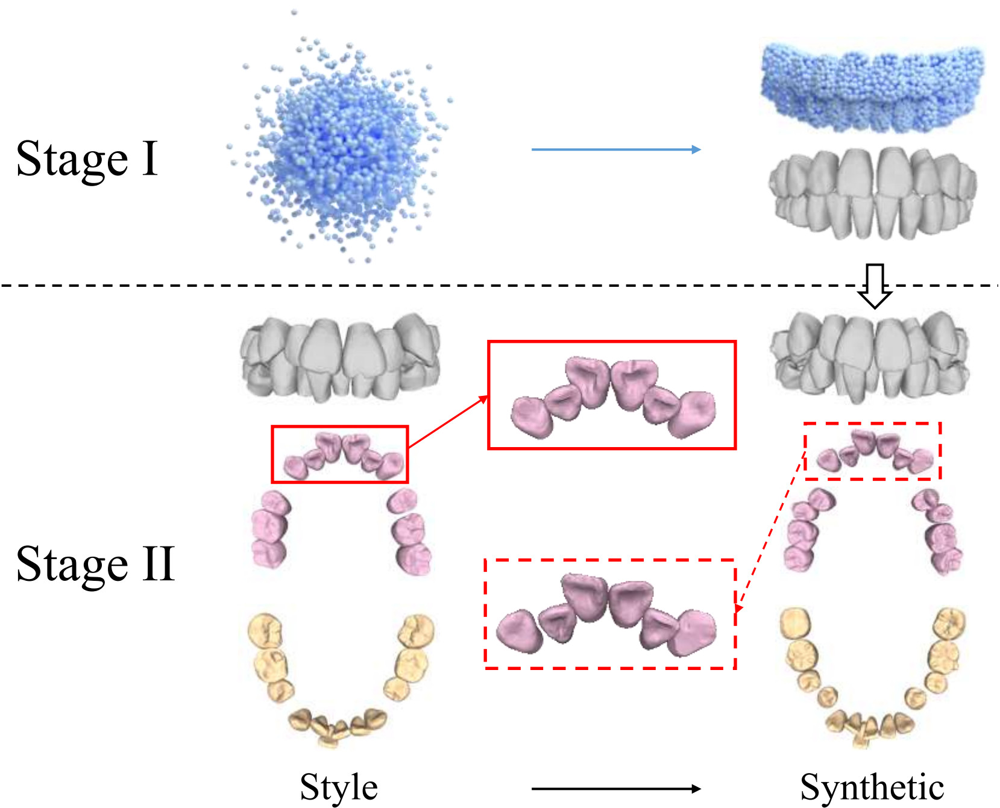

<div align="center">
<h2> TeethGenerator: A two-stage framework for paired pre- and post-orthodontic 3D dental data generation
</div>
<p align="center">
    
</p>

We will release the code and dataset of the paper *TeethGenerator: A two-stage framework for paired pre- and post-orthodontic 3D dental data generation* in this repository.

## Dataset
See the [Data Use Agreement](./Data-Use-Agreement.pdf) for details.

## Install Requirements
We test our model with Python 3.10 and PyTorch 2.7.1+cu118.
```bash
conda create -n teeth_generator python=3.10
conda activate teeth_generator
pip install torch torchvision torchaudio --index-url https://download.pytorch.org/whl/cu118
pip install -r requirements.txt
```

## Data Pre-process
Please refer to [TADPM](https://github.com/lcshhh/TADPM) or alternatively, you can handle it using your own code. The steps you need to follow are:
- Normalize and center the entire teeth model.
- Extract each individual tooth and use the FPS algorithm to sample 128 points from each tooth.
- Make sure that the sampled points of the teeth before and after orthodontics correspond one-to-one.


